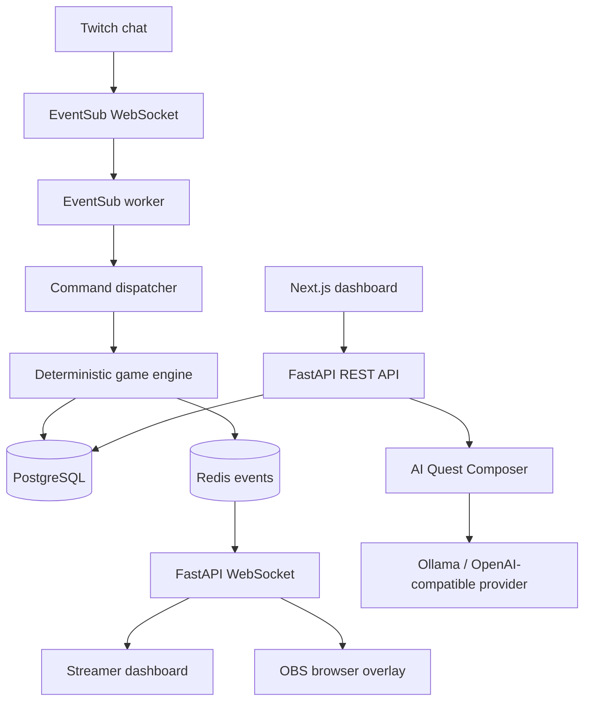

# CrowdQuest AI

**The Audience Is The Game.**

CrowdQuest AI is a Twitch-connected collaborative quest platform. A streamer composes an adventure, viewers choose the next path through real Twitch chat commands, and the community works toward a shared objective. The streamer remains in control, the AI proposes story content, and a deterministic backend owns votes, progression, and rewards.

This repository contains the complete application source, backend services, Twitch EventSub worker, persistent data model, frontend, OBS browser overlay, migrations, tests, infrastructure configuration, and operational documentation.

> This repository does not ship with a demo mode or simulated Twitch audience. Real Twitch credentials and a registered Twitch developer application are required for live channel integration.

## Product capabilities

- Twitch OAuth authorization-code flow and encrypted token storage.
- Twitch EventSub WebSocket client for `channel.chat.message`.
- Twitch Helix chat messaging when the broadcaster grants `user:write:chat`.
- Real chat commands: `!quest`, `!vote 1`, `!vote 2`, `!vote 3`, `!help`, `!stats`, and `!leaderboard`.
- Deterministic state machine, first-vote-wins enforcement, tie policy, one contribution per viewer per round, configurable voting/objective deadlines, pause/resume clock preservation, and transactional XP rewards.
- AI Quest Composer with Ollama and configurable OpenAI-compatible provider support.
- Strict Pydantic schema validation and deterministic content fallback when a provider is unavailable.
- PostgreSQL persistence and Redis-based rate limiting/realtime fan-out.
- Streamer dashboard, Quest Studio, live control center, community leaderboard, analytics, and settings.
- Secure OBS browser overlay with a revocable private token and live WebSocket updates.
- Alembic migration, Docker Compose deployment, CI, automated tests, and operational docs.

## Architecture



See [Architecture](docs/ARCHITECTURE.md), [Gameplay](docs/GAMEPLAY.md), [Twitch setup](docs/TWITCH_SETUP.md), [Deployment](docs/DEPLOYMENT.md), and the [build/verification status](PROJECT_STATUS.md).

## Requirements

- Docker Desktop with Docker Compose v2 (recommended local workflow).
- Twitch Developer application credentials.
- Optional AI runtime: Ollama reachable from the API container, or an OpenAI-compatible endpoint.
- For production: a domain, HTTPS reverse proxy, durable PostgreSQL/Redis storage, backups, and secret management.

## Quick start — Windows / PowerShell

1. Install and start Docker Desktop.
2. From the repository root, create a local environment file:

```powershell
python scripts/bootstrap_env.py
```

3. Open `.env` and set:
   - `TWITCH_CLIENT_ID`
   - `TWITCH_CLIENT_SECRET`
   - `TWITCH_REDIRECT_URI` (must exactly match the Twitch Developer Console callback URL)
   - Optionally `OLLAMA_MODEL` and AI endpoint settings.
4. Register the same redirect URL in the Twitch Developer Console:

```text
http://localhost:8000/api/v1/auth/twitch/callback
```

5. Start the application:

```powershell
docker compose up --build -d
```

6. Open:
   - Web application: http://localhost:3000
   - API health: http://localhost:8000/health/ready
   - OpenAPI docs: http://localhost:8000/api/docs

7. Select **Connect with Twitch**. Approve the requested scopes. Create a quest, open its live control center, and generate an OBS overlay URL.

### AI provider configuration

The default provider is Ollama. The API container uses `host.docker.internal:11434` to reach an Ollama process running on the host. On Windows, start Ollama and pull the model configured in `.env` before generating AI quests.

Example:

```powershell
ollama pull qwen2.5:7b-instruct
```

For a compatible hosted model endpoint, set:

```env
AI_PROVIDER=openai_compatible
OPENAI_COMPATIBLE_BASE_URL=https://your-provider.example/v1
OPENAI_COMPATIBLE_API_KEY=your-secret
OPENAI_COMPATIBLE_MODEL=your-model
```

The provider is accessed only by the backend. Do not put provider keys in `NEXT_PUBLIC_*` variables.

## Twitch chat commands

| Command | Behaviour |
|---|---|
| `!quest` | Shows the current quest state in chat when chat-send permission is available. |
| `!vote 1` | Votes for mission path 1 during an open voting round. |
| `!vote 2` | Votes for mission path 2 during an open voting round. |
| `!vote 3` | Votes for mission path 3 during an open voting round. |
| `!help` | Adds one eligible contribution per viewer per round while an objective is active. |
| `!stats` | Returns the current quest status when chat-send permission is available. |
| `!leaderboard` | Directs viewers to the community leaderboard. |

Voting and contribution identity is based on Twitch chatter user IDs. Repeated EventSub delivery is deduplicated. The first accepted vote per viewer per round is final.

## OBS setup

1. Open a session in the dashboard.
2. In **OBS broadcast**, create a private overlay URL.
3. In OBS, add a **Browser Source**.
4. Paste the private overlay URL.
5. Set a suitable source size (1920 × 1080 is recommended); crop or position it within the scene.
6. Keep the URL private. Rotate it from the session control center if it is exposed.

The overlay URL is a bearer secret: anyone who possesses it can view that session's public overlay.

## Run tests

Backend:

```powershell
cd apps/api
python -m pip install -e ".[dev]"
ruff check app tests
pytest -q
```

Frontend:

```powershell
cd apps/web
npm install
npm run typecheck
npm run lint
npm run build
```

A real Twitch end-to-end test requires a configured developer application, a broadcaster who authorizes the app, and a live chat session. Unit tests do not claim that external Twitch connectivity has been exercised.

## Configuration and secrets

- `.env` is generated locally and ignored by Git.
- `APP_SECRET_KEY` signs application sessions.
- `TOKEN_ENCRYPTION_KEY` encrypts Twitch access and refresh tokens at rest.
- `TWITCH_CHAT_RESPONSE_COOLDOWN_SECONDS` gates outgoing chat replies per broadcaster so busy chat activity does not trigger avoidable send-rate bursts.
- PostgreSQL and Redis passwords are generated by the bootstrap script.
- Keep `COOKIE_SECURE=false` only for local HTTP development. Production must use HTTPS and `COOKIE_SECURE=true`.
- Rotate secrets if they are exposed. Changing `TOKEN_ENCRYPTION_KEY` without re-encrypting stored credentials makes existing Twitch tokens unreadable.

## Production deployment

The included Docker Compose file is a production-oriented single-host starting point. API and web ports bind to loopback by default so a host-based Caddy reverse proxy can serve them without directly exposing application ports. Before public deployment:

1. Set `APP_ENV=production`.
2. Set `COOKIE_SECURE=true`.
3. Set `FRONTEND_URL`, `BACKEND_URL`, `CORS_ORIGINS`, `TWITCH_REDIRECT_URI`, and `NEXT_PUBLIC_API_URL` to your HTTPS domain.
4. Configure the exact HTTPS Twitch callback in the Twitch Developer Console.
5. Put Caddy, Nginx, or a managed ingress in front of the web and API containers.
6. Remove public direct exposure of PostgreSQL and Redis; they are not published by Compose.
7. Configure automated encrypted backups and test restore procedures.
8. Keep one active `twitch-worker` replica per deployment until distributed EventSub ownership/leases are implemented and verified.
9. Monitor API/worker logs, database availability, Redis availability, Twitch token status, and reconnect health.
10. Pin container image digests and dependency lockfiles before a regulated or high-availability production rollout.

See [Deployment](docs/DEPLOYMENT.md) for the operational checklist.

## Known operational boundaries

- The EventSub supervisor is designed as a single active worker process. Do not horizontally scale it without adding and validating distributed per-broadcaster leases.
- Twitch may revoke access or EventSub subscriptions. The worker marks accounts that require reauthorization; the broadcaster must reconnect.
- Model output is untrusted. Schema validation is enforced, but a production deployment should add provider-specific safety evaluation and moderation review appropriate to its community.
- This codebase is production-oriented, not a claim of completed third-party security certification, load testing, or a verified live Twitch deployment. Those require deployment-specific credentials and operational testing.

## License

MIT. See [LICENSE](LICENSE).
